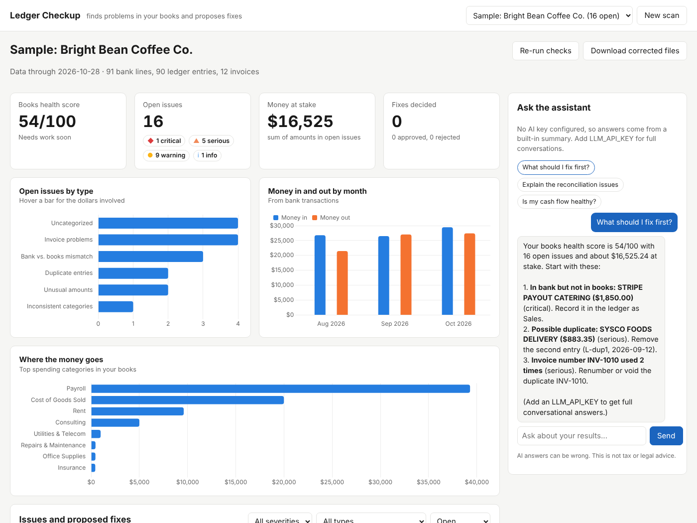

# Ledger Checkup

**Automated bookkeeping review for small businesses.** Upload bank, ledger and invoice CSVs; Ledger Checkup finds the problems an accountant would look for, explains each one in plain English with its dollar impact, and proposes a fix. **Nothing changes until the owner approves it.** A built-in AI assistant (free LLM tier) walks the owner through the results.



> All data in this repository is synthetic (a fictional coffee shop). No real financial data, credentials or keys are stored here.

## What it checks

| Check | What it catches | Proposed fix |
|---|---|---|
| Duplicate entries | Same payee and amount within a day, in the bank or the ledger | Delete the ledger copy, or ask the vendor to refund a double bank charge |
| Uncategorized | Blank, "Uncategorized", "Ask My Accountant", "Suspense"... | Category learned from the vendor's history, else keyword rules |
| Inconsistent categories | One vendor filed under a different category than its usual one | Recategorize to the majority category |
| Bank vs. books mismatch | Bank lines with no ledger entry and vice versa (amount + date window matching) | Add the missing ledger entry, or review the phantom one |
| Unusual amounts | Robust outliers per category (median/MAD z-score), large round-number payments | Review receipt / confirm it isn't an owner draw |
| Invoice problems | Duplicate invoice numbers, gaps in numbering, overdue invoices, unpaid invoices that match a bank deposit | Mark paid, send reminder, renumber/void |

Every issue gets a severity (critical / serious / warning / info), an explanation of *why it matters*, the money at stake, and a fix. Approved fixes update a working copy of the books, are recorded in an audit log, and can be downloaded as corrected CSVs. Re-running the checks keeps previously rejected items rejected.

## Architecture

```
 CSV uploads ──► importers.py ──► Dataset ──► checks.py ──► Issues + proposed Fixes
 (bank, ledger,   (loose column                (6 detectors,     │
  invoices)        matching)                    no side effects)  ▼
                                                        FastAPI (main.py) ◄──► SQLite (store.py)
                                                         │        │
                                    owner approves ──► fixes.py   └──► llm.py ──► any OpenAI-compatible API
                                    (audit log, CSV export)                         (Groq free tier by default,
                                                         │                           Gemini, OpenRouter, Ollama)
                                                         ▼
                                              Dashboard (vanilla JS + Chart.js)
```

- **Backend:** Python 3.12, FastAPI, stdlib `csv`/`statistics` (no pandas, so it runs comfortably on a 1 GB instance).
- **Storage:** SQLite file on the server's disk.
- **Frontend:** a single page with no build step; Chart.js is vendored (MIT).
- **LLM:** the assistant only receives the scan summary and issue list, never raw uploads. Without an API key it falls back to a deterministic summary, so the app works fully offline.
- **Importers are pluggable:** add a function that returns a `Dataset` to support QuickBooks, Xero or Plaid.

## Run locally

```bash
python -m venv .venv && source .venv/bin/activate
pip install -r requirements-dev.txt
cp .env.example .env          # optional: add LLM_API_KEY / APP_PASSWORD
uvicorn app.main:app --reload
# open http://localhost:8000 and click "Try it with sample data"
pytest -q                     # 13 tests
```

Or with Docker: `docker compose up --build` and open http://localhost.

### CSV formats

Column names are matched loosely (e.g. `Date` / `Posted Date`, `Description` / `Memo` / `Payee`, `Amount` or `Debit`+`Credit`). See [`sample_data/`](sample_data/) for examples, and [`scripts/make_sample_data.py`](scripts/make_sample_data.py) for the list of planted problems.

## Free LLM options

Set these in `.env` (never commit it):

| Provider | `LLM_BASE_URL` | Example `LLM_MODEL` | Notes |
|---|---|---|---|
| Groq (default) | `https://api.groq.com/openai/v1` | `llama-3.3-70b-versatile` | Free tier with rate limits; key at console.groq.com |
| Google Gemini | `https://generativelanguage.googleapis.com/v1beta/openai` | `gemini-2.5-flash` | Free tier with rate limits |
| Ollama (self-hosted) | `http://localhost:11434/v1` | `llama3.2` | No key; data never leaves your machine, needs more RAM than a micro instance |

Model names change over time; check the provider's model list if you get an error. Free tiers may use prompts to improve their services, so read the provider's terms before sending real client data.

## Deploy to AWS (free tier)

One EC2 micro instance running Docker, with Caddy in front (automatic HTTPS if you have a domain). Secrets live in **SSM Parameter Store** as encrypted SecureStrings and are read by the instance at boot, so they never touch Git or the CloudFormation template. No SSH port is opened; use SSM Session Manager.

```bash
aws configure                                   # your own AWS account
./deploy/aws/deploy.sh ledger-checkup us-east-1 # prompts for app password + LLM key
# optional overrides: Domain=books.example.com AllowedCidr=203.0.113.7/32
```

Cost notes: AWS accounts created after July 15, 2025 get the new Free Plan (up to $200 in credits for 6 months) instead of 12 months of free usage. A t3.micro (or t2.micro), a 10 GB gp3 volume and a public IPv4 address fit within it. Set an AWS Budget alert to be safe, and delete the stack (`aws cloudformation delete-stack --stack-name ledger-checkup`) when you're done.

## Security

- Set `APP_PASSWORD` whenever the app is reachable from the internet (HTTP Basic auth on every route except `/health`).
- Uploaded books and the database stay on the server (`data/` is git-ignored).
- Restrict `AllowedCidr` to your own IP for extra protection.

## Roadmap

- QuickBooks Online / Xero import via OAuth
- Multi-user accounts and per-business workspaces
- Scheduled monthly scans with email summaries
- Sales-tax and payroll-tax sanity checks

## Disclaimer

Ledger Checkup helps spot likely bookkeeping problems. It is not a substitute for a CPA, and its AI answers can be wrong.

## License

MIT
